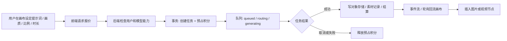

# 03 · Atelier React + Rust 工程化迭代说明

日期：2026-10-21 | 阶段：工程骨架 + 画布领域拆分 + API MVP

## 0. 目的和设计原则

你已经确认的 Atelier UI 风格继续保留：简洁偏白、灰色细边框、无紫色荧光、接近 Codex 桌面端的操作密度。产品仍为**一个前端项目**：普通用户创建对话和无限画布、管理员额外拥有运营菜单、超级管理员负责更敏感的权限；角色要以后端的 `GET /me` 为准。

本轮完成组件化迁移的第一步：真实 React + TypeScript 页面、可编辑的图片/视频/文本/生成配置/任务节点，使用 @xyflow/react 管理图关系；同时提供 Rust Axum + PostgreSQL 的画布与积分任务接口基础代码。

> 边界：**不是生产可用系统**。Google OIDC、付费订阅、正式对象存储和供应商模型未实现。Mock 与 HTTP 两种模式故意清晰区分。

## 1. 页面与路由

| URL | 所有者 | 说明 | 页面组件 |
|---|---|---|---|
| `/` | 所有已登录账号 | 最近项目、入口、积分概况 | `App.tsx > Dashboard` |
| `/chat` | USER+ | Agent 对话外观、模拟意图识别 | `ChatPage.tsx` |
| `/canvas` | USER+ | 无限画布、生成面板、属性、任务 | `CanvasPage.tsx` |
| `/assets` | USER+ | 图片 / 视频素材库 | `App.tsx > AssetsPage` |
| `/wallet` | USER+ | 余额、套餐、签到、流水 | `App.tsx > WalletPage` |
| `/usage` | USER+ | 模拟消耗分析 | `App.tsx > UsagePage` |
| `/admin` | ADMIN+ | 运营看板 | `AdminPage.tsx` |
| `/admin/users` | ADMIN+ | 管理用户、积分调整（Mock） | `AdminPage.tsx` |
| `/admin/models` | ADMIN+ | 开放模型开关（Mock） | `AdminPage.tsx` |
| `/admin/providers` | ADMIN+ | 账号池与供应商概况 | `AdminPage.tsx` |

导航按 `hasPermission(role,permission)` 渲染，受限路由会重定向。**这是用户体验层权限，不是安全边界。Rust 的每个写接口必须再次校验。**

## 2. 无限画布如何实现

### 2.1 图形模型

核心库 `@xyflow/react`：内置节点布局、画布变换、选中、拖拽、缩放、连线、Edge 和 MiniMap。节点数据独立存储，避免把供应商敏感信息塞进画布 JSON。

```ts
CanvasGraph = {
  nodes: CanvasNode[],
  edges: Edge[],
  viewport: {x:number, y:number, zoom:number}
}
```

| 节点 | 当前实现 | 下一步增强 |
|---|---|---|
| `text` | 文字便签、尺寸调整、端点连接 | Markdown / 模板变量 / Prompt 引用 |
| `image` | 缩略图、输入输出端口、尺寸调整 | 放大编辑、局部重绘、素材版本关系 |
| `video` | 可播放 MP4、缩略封面、尺寸调整 | 首尾帧、拖动片段、转码状态 |
| `config` | 模型、画质、比例、媒体类型展示 | 模型能力表驱动、联动上下游节点 |
| `task` | 排队、路由、生成进度、取消 | SSE 订阅、错误恢复、重试、产物对比 |

**节点连线目前是可编辑的图数据**，尚未实现严格 DAG 检查与按图执行。MVP2 要增加 `sourcePort/targetPort` 类型、禁止循环、生成节点读取输入端口的素材 ID、工作流拓扑调度。不要误以为“能连线”就等于已经有一个自动执行的工作流引擎。

### 2.2 画布状态保存

- Mock：`localStorage`，按用户 ID 过滤不同项目，前端状态库按 revision 保存，旧版本冲突拒绝。
- HTTP：`GET /projects` 拉取项目，`PUT /projects/{id}/graph` 携带 `If-Match`，SQL 以 `WHERE owner_id=... AND revision=...` 条件更新。
- 当前 autosave 为 850ms debounce；后续建议移动/缩放做增量事务并保留最近修改版本。
- 图片、视频必须由独立 `asset_id` 标识，不在 Graph JSON 中直接嵌入大型 Base64。当前只用示例 URL / 本地 blob 演示。

推荐增强：`canvas_snapshot` + `canvas_operations`（坐标事件、文本编辑、连线更新）分离。多人协作前先确定服务端操作序列与冲突处理，不要立刻上 CRDT。

### 2.3 生图 / 视频完整业务链路



当前 Demo 的 `mockDb` 负责模拟任务状态，并将示例图片或 MP4 作为产物；Rust 服务端同样只有 Mock Worker。真实供应商 URL、凭据和用户订阅账号**均不应暴露给前端**。

### 2.4 费用与状态

Mock 规则（仅为了界面验证）：

```
image: ceil(12 × qualityMultiplier × count)
video: ceil(18 × qualityMultiplier × count × durationSeconds)
low/480p=1.0; medium/720p=1.5; high/1080p=2.0
```

**实际定价必须由 Rust 报价接口决定**。客户端可能被篡改，不允许传入 `cost=1` 直接生图；后台账户或模型限额也要在路由前再查。

### 2.5 参考图、视频首尾帧和下一阶段字段

现有左侧面板已支持选择参考素材，并把 `referenceAssetIds` 附在任务请求中；Rust 通过 `owner_id` 校验它们。但 Mock Worker **还不会让参考素材影响生成像素**，后续接真实模型时需要定义首帧、尾帧和风格参考等具体角色，建议扩展为以下结构：

```json
{
  "projectId":"...",
  "nodeId":"...",
  "kind":"video",
  "model":"motion-v2",
  "prompt":"暮色海边公路，缓慢推进镜头",
  "quality":"720p",
  "ratio":"16:9",
  "duration":6,
  "count":1,
  "references":[
    {"assetId":"asset-first","role":"FIRST_FRAME"},
    {"assetId":"asset-last","role":"LAST_FRAME"}
  ],
  "quoteId":"quote-server-signed"
}
```

后端必须验证 asset 所属权、模型是否支持当前参考模式、图片尺寸和素材处理完成状态。

## 3. Mock / HTTP 模式切换

- `VITE_API_MODE=mock`：本地 Demo，所有入口可操作，无需数据库；不具备安全认证。
- `VITE_API_MODE=http`：登录页调用仅本地允许的 `/dev/login`，随后用 Cookie 请求 `/me`、项目、任务、素材与钱包；React 定时刷新服务器状态。
- 未实现的 HTTP 管理写接口、上传和签到入口在代码中禁用或提示，不会静默伪造“已成功写入服务器”。
- 生产环境要删除演示登录，加入 Google Code+PKCE OIDC，并在后端授权敏感操作。

## 4. Rust 架构边界

`services/api/src/main.rs` 当前为了方便首次启动，把 handlers、认证与 Mock Worker 放在一个文件。正式开发建议逐步重构成：

```text
src/
├── main.rs               # 启动 / 生命周期
├── app.rs                # 路由与统一依赖组装
├── auth/{oidc,session,csrf}.rs
├── rbac.rs               # 角色 + 细粒度 Permission
├── canvas/{handlers,service,repo}.rs
├── generation/{handlers,service,queue,worker,provider}.rs
├── wallet/{ledger,pricing,reservations}.rs
├── assets/{storage,ffprobe,handlers}.rs
└── admin/{users,models,routing,audit}.rs
```

不要马上拆微服务。优先在单 Rust 进程中确定协议边界，等视频 FFmpeg 负载达到需要隔离时再拆 Worker。

## 5. 未来建议开发顺序（从本轮继续）

| 里程碑 | 交付内容 | 验收 |
|---|---|---|
| M1 组件构建 | `npm install` / `npm run build` / 浏览器 UI 回归 | Windows 机器可打开，组件无运行时错误 |
| M2 Rust 接口联调 | Cargo 编译、PostgreSQL 迁移、任务状态与取消 | 真实 HTTP 项目保存，刷新不丢失；扣退无重复 |
| M3 登录与权限 | Google OIDC、Session、后台注册开关、MFA | 假 Token、越权 ID、封禁后请求全部被拒 |
| M4 上传与媒体 | S3、直传、FFmpeg thumbnail、播放授权 | 图片视频刷新可播放，任何人不能读取别人素材 |
| M5 真实生图 | 官方/授权供应商 API、报价、任务队列 | 多次重试不重复扣费；取消不重复生成 |
| M6 真实生视频 | 首帧/尾帧、进度、转码、重试、资产回流 | 视频可播放，任务断网恢复后能继续查状态 |
| M7 高级画布 | 框选、组合、节点拖动到输入口、版本时间线 | 复杂画布稳定，撤销符合用户预期 |
| M8 商业化 | 支付回调、积分套餐、签到防刷、审计 | 退款/对账正确；管理员所有操作可审计 |

## 6. 本轮尚未实现的要素（必须透明）

- 本轮未接入 `basketikun/infinite-canvas` 的原始工作流执行器，也没有声称全功能复刻。
- 连线只是编辑图，不代表具备视频多轨时间轴、动态资源裁剪、音频节点、自动批量运行和多端协作。
- React 代码已做转译语法校验，但当前环境无法下载 npm 依赖，也没有运行完整 TS 类型检查 / Vite build / 页面浏览器自动化。
- Rust 源码未在当前环境运行 Cargo，生产测试和数据库迁移请按 README 在本机执行。
- 开发会话使用显式 `DEV_AUTH=true` + loopback 地址限制。正式部署绝对不能启用此模式。
